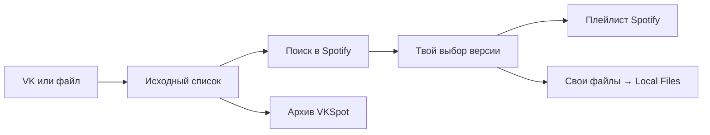

<p align="center">
  
</p>

# VKSpot 🎵

**Сохрани список музыки из VK и перенеси проверенные треки в Spotify.**

VKSpot — бесплатное приложение для Windows с открытым кодом. Оно сохраняет оригинальный список, помогает найти нужные версии песен и собрать плейлист. Порядок и повторы остаются на месте, спорные совпадения выбираешь ты.

**🪟 Windows 10/11 · 💾 Данные на компьютере · 🌗 Две темы · 📜 MIT**

## Что получаешь

- **Архив медиатеки.** Забери «Мою музыку» из VK или импортируй JSON, CSV, TXT. Сохрани исходные названия, позиции и отдельные повторы.
- **Проверку совпадений.** Сравни исполнителя, название, длительность и версию. Подтверди подходящие результаты группой или разбери записи по одной.
- **Плейлист Spotify.** Перенеси подтверждённые каталожные треки через Spotify API. Поиск и перенос можно приостановить и продолжить после перезапуска.
- **Путь для редких записей.** Привяжи свой аудиофайл, если нужной версии нет в Spotify. VKSpot подготовит копии для Local Files и план общего порядка.
- **Контроль над изменениями.** Правь рабочую копию, отменяй решения, откладывай или исключай записи. Оригинал сохраняется.

<picture>
  <source media="(prefers-color-scheme: dark)" srcset="docs/images/workspace-dark.png">
  
</picture>

_Настоящий интерфейс на вымышленных данных. Тема снимка следует теме GitHub._

## Что потребуется

| Для чего                            | Что нужно                                                                                                                                                                                                                                                                       |
| ----------------------------------- | ------------------------------------------------------------------------------------------------------------------------------------------------------------------------------------------------------------------------------------------------------------------------------- |
| Запустить приложение                | Windows 10/11, 64-разрядная система (x64). Node.js для установщика не нужен.                                                                                                                                                                                                    |
| Работать со своим списком и архивом | Файл JSON, CSV, TXT или архив VKSpot. Разбор и сохранение работают локально.                                                                                                                                                                                                    |
| Забрать список из VK                | Интернет и вход в свой аккаунт VK во встроенном окне.                                                                                                                                                                                                                           |
| Искать версии в Spotify             | Доступ к веб-плееру Spotify. При запросе сервиса — вход или проверка. Client ID для этого способа не нужен.                                                                                                                                                                     |
| Создать плейлист через API          | Аккаунт Spotify и личное приложение в Developer Dashboard. В режиме разработки Spotify требует Premium у владельца приложения; действуют квоты и список разрешённых пользователей. [Правила Spotify](https://developer.spotify.com/documentation/web-api/concepts/quota-modes). |
| Добавить отсутствующие версии       | Свои аудиофайлы и настольный Spotify с включёнными Local Files.                                                                                                                                                                                                                 |

При необходимости в «Подключениях» можно настроить отдельные HTTP/SOCKS5-прокси для Spotify и VK.

## 🚀 Быстрая установка

1. Открой **Releases** на странице этого репозитория.
2. В разделе **Assets** скачай `VKSpot Setup <версия>.exe` и запусти установщик.
3. Открой VKSpot → **Подключения → VK → Открыть VK**, войди и нажми **Выгрузить мой список**. Если список уже сохранён, выбери **Импорт списка**.
4. Проверь количество, первые и последние записи, затем запусти поиск из «Обзора» или коллекции.

Если готового релиза ещё нет, приложение можно [собрать из исходников](#сборка-из-исходников).

## 🎧 От списка к плейлисту



Найденный кандидат ещё не считается выбранным треком. Проверь версии и подтверди решения. Для создания плейлиста [подключи Spotify API](docs/workflows.md#подключение-spotify-api), затем нажми **Проверить перенос**.

**Если нужной версии нет:** привяжи файл с компьютера. VKSpot копирует его без перекодирования; добавление через Local Files и проверка смешанного порядка требуют действий в настольном Spotify. Файлы должны быть доступны на устройстве воспроизведения.

**Для резервной копии:** открой параметры коллекции и сохрани полный архив VKSpot. Он содержит список и решения, но **не аудиофайлы**. Также доступны исходный JSON, CSV, план переноса и M3U8.

## Что важно знать

- VKSpot архивирует список и готовит перенос; скачивания музыки из VK в приложении нет.
- Разметка VK/Spotify, доступность треков и ограничения сервисов меняются. Сверяй полноту выгрузки; пустой поиск не доказывает отсутствие трека.
- Коллекции, история и настройки хранятся локально. Телеметрии нет; обращения к VK и Spotify нужны для их функций. Подробнее — [безопасность и приватность](SECURITY.md).
- VKSpot — независимый проект. VK и Spotify не являются его разработчиками и не заявляют о его поддержке.

## Сборка из исходников

Потребуются **Windows x64 и Node.js 24 LTS с npm**; для клонирования — Git. Склонируй этот репозиторий или распакуй **Code → Download ZIP**, затем открой PowerShell в папке проекта:

```powershell
npm ci
npm run dev
```

Чтобы получить установщик:

```powershell
npm run dist:win
```

Результат — `release/<версия>/VKSpot Setup <версия>.exe`.

## Обратная связь и участие

Для ошибки создай **Issue**: укажи версию VKSpot, версию Windows, шаги и ожидаемый результат. Прикладывай только обезличенные примеры. Об уязвимостях сообщай по [SECURITY.md](SECURITY.md).

Хочешь помочь с кодом? Начни с [правил проекта](AGENTS.md) и [команд проверки](docs/maintenance.md). Карта документации:

| Документ                              | Содержание                                   |
| ------------------------------------- | -------------------------------------------- |
| [Рабочие процессы](docs/workflows.md) | Импорт, подключение Spotify, поиск и перенос |
| [Продукт](PRODUCT.md)                 | Возможности и неизменяемые правила           |
| [Архитектура](docs/architecture.md)   | Модули, хранение и синхронизация             |
| [Дизайн](DESIGN.md)                   | Токены и правила интерфейса                  |

Код распространяется по [лицензии MIT](LICENSE). Права на названия и знаки VK и Spotify принадлежат их владельцам.
