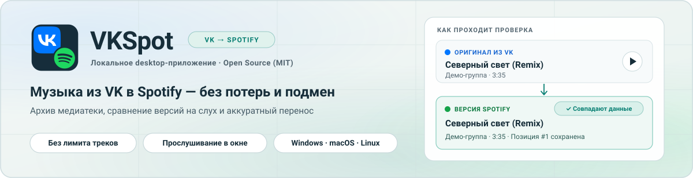
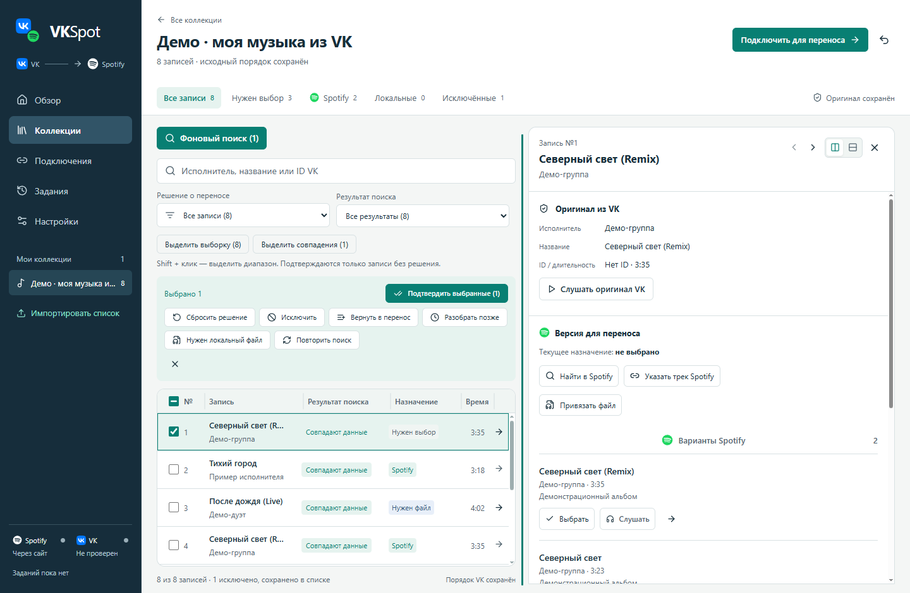
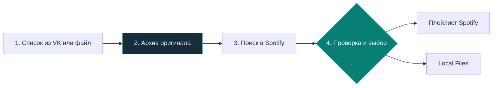
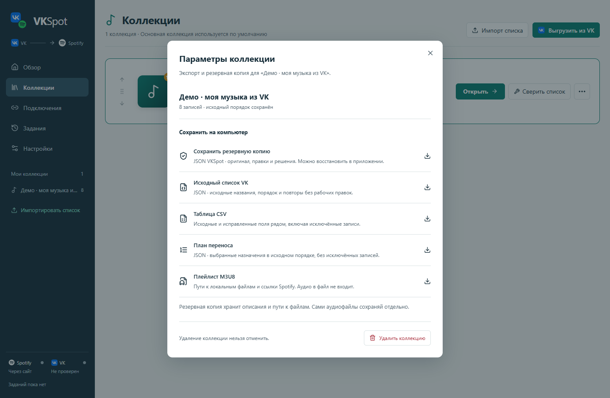

<p align="center">
  <a href="https://github.com/Matvey77/VKSpot/releases/latest">
    <picture>
      <source media="(prefers-color-scheme: dark)" srcset="docs/images/hero-dark.svg">
      
    </picture>
  </a>
</p>

<p align="center">
  <strong>Бесплатное приложение на твой компьютер: сохраняет медиатеку VK, помогает проверить каждый ремикс на слух и собирает плейлист в Spotify — без лимитов, облаков и скрытых подмен.</strong>
</p>

<p align="center">
  <a href="https://github.com/Matvey77/VKSpot/releases/latest">
    
  </a>
  <a href="https://github.com/Matvey77/VKSpot/releases/latest">
    
  </a>
  <a href="https://github.com/Matvey77/VKSpot/actions/workflows/checks.yml">
    
  </a>
  <a href="#скачивание-и-установка">
    
  </a>
  <a href="LICENSE">
    
  </a>
</p>

<p align="center">
  <a href="#почему-vkspot-а-не-онлайн-переносильщик">Почему VKSpot</a>
  &nbsp;·&nbsp;
  <a href="#возможности">Возможности</a>
  &nbsp;·&nbsp;
  <a href="#как-это-работает">Как это работает</a>
  &nbsp;·&nbsp;
  <a href="#интерфейс">Интерфейс</a>
  &nbsp;·&nbsp;
  <a href="#скачивание-и-установка">Установка</a>
  &nbsp;·&nbsp;
  <a href="#частые-вопросы">FAQ</a>
  &nbsp;·&nbsp;
  <a href="#для-разработчиков">Разработка</a>
</p>

<p align="center">
  <picture>
    <source media="(prefers-color-scheme: dark)" srcset="docs/images/workspace-dark.png">
    
  </picture>
  <br>
  <sub>Слева — вся коллекция с фильтрами и групповым подтверждением; справа — оригинал из VK, найденные варианты Spotify и прослушивание прямо в окне.</sub>
</p>

---

## Почему VKSpot, а не онлайн-переносильщик

Обычные веб-сервисы просят подписку за большие плейлисты, молча подменяют редкие ремиксы первыми попавшимися каверами и требуют пароль или доступ через сторонний сервер. **VKSpot устроен наоборот:**

| Обычный перенос в браузере                        | VKSpot на твоём компьютере                                                                                 |
| ------------------------------------------------- | ---------------------------------------------------------------------------------------------------------- |
| Лимит 200–500 треков бесплатно, дальше — подписка | **Полностью бесплатно и без лимита треков** (проверено на коллекциях **9 000+ записей**)                   |
| Молча ставит кавер, live или другой ремикс        | **Найдено ≠ выбрано:** точные совпадения принимаются группой, спорные сравниваются визуально и **на слух** |
| Схлопывает повторы и ломает порядок треков        | **Неизменяемый архив оригинала:** каждый повтор и позиция сохраняются отдельно, любые правки обратимы      |
| Редкие и удалённые из каталога треки теряются     | **Поддержка `Local Files`:** подготавливает локальные аудиофайлы без перекодирования в общем порядке       |
| Пароли, списки и токены идут через чужой сервер   | **100% локально:** база SQLite у тебя на диске, без облака и телеметрии, отдельные прокси для VK и Spotify |

---

## Возможности

<table>
  <tr>
    <td width="50%" valign="top">
      <strong>📥 Неубиваемый архив VK</strong><br>
      <sub>Выгружает «Мою музыку» из встроенного окна VK или импортирует <code>JSON</code>, <code>CSV</code> и <code>TXT</code>. Исходные названия, позиции и повторы защищены от случайных правок и всегда доступны для отката (Undo).</sub>
    </td>
    <td width="50%" valign="top">
      <strong>🎧 Сравнение на слух в одном окне</strong><br>
      <sub>Не нужно открывать десятки вкладок: слушай оригинал из VK и превью кандидатов Spotify прямо в инспекторе, чтобы отличить студийную запись от концертной версии или ремикса.</sub>
    </td>
  </tr>
  <tr>
    <td width="50%" valign="top">
      <strong>🔎 Умный поиск без API-ключей</strong><br>
      <sub>Поиск работает через встроенный веб-плеер Spotify и не требует Client ID. Алгоритм учитывает <code>ё/е</code>, транслитерацию, гостевых исполнителей и длительность, а пометки показывают, где данные совпали полностью.</sub>
    </td>
    <td width="50%" valign="top">
      <strong>📂 Свои аудиофайлы (<code>Local Files</code>)</strong><br>
      <sub>Если редкого трека нет в каталоге Spotify, привяжи свой файл. VKSpot подготовит копии без перекодирования и поможет сверить смешанный порядок в плейлисте.</sub>
    </td>
  </tr>
  <tr>
    <td width="50%" valign="top">
      <strong>⏯️ Пауза, перезапуск и прокси</strong><br>
      <sub>Фоновый поиск и перенос сохраняют прогресс в SQLite, переживают закрытие программы и уважают лимиты Spotify. Для VK и Spotify можно задать отдельные HTTP/SOCKS5-прокси.</sub>
    </td>
    <td width="50%" valign="top">
      <strong>💾 Полный контроль и экспорт</strong><br>
      <sub>Никакой телеметрии и облачных аккаунтов. В любой момент можно выгрузить полную резервную копию (<code>JSON</code>), исходный список VK, таблицу <code>CSV</code>, план переноса или плейлист <code>M3U8</code>.</sub>
    </td>
  </tr>
</table>

---

## Как это работает



1. **Забери список** — открой **Подключения → VK**, войди в аккаунт и выгрузи «Мою музыку» ([как работает выгрузка](docs/workflows.md#импорт-и-выгрузка-vk)), либо нажми **Импортировать список** для `JSON`, `CSV`, `TXT` или архива VKSpot.
2. **Запусти поиск** — VKSpot сам пройдёт по списку через встроенный веб-плеер Spotify (Client ID не нужен). Можно поставить на паузу и продолжить после перезапуска.
3. **Подтверди нужное** — точные совпадения прими одной кнопкой, спорные послушай в инспекторе, а для редких треков привяжи свои аудиофайлы.
4. **Собери плейлист и сохрани бэкап** — [подключи Spotify API](docs/workflows.md#подключение-spotify-api) для создания плейлиста и сохрани резервную копию в **Параметрах коллекции** ([очереди и форматы](docs/workflows.md#очереди-и-перенос)).

> [!TIP]
> **Про сеть и квоты:** если Spotify или VK требуют обход региональных ограничений, задай независимые HTTP/SOCKS5-прокси в разделе **Подключения**. Квоты Spotify Development Mode относятся только к созданию плейлиста через API — архив и поиск через сайт от них не зависят.

---

## Интерфейс

<table>
  <tr>
    <td width="50%" align="center">
      <picture>
        <source media="(prefers-color-scheme: dark)" srcset="docs/images/overview-dark.png">
        
      </picture>
      <br><sub><strong>Обзор</strong> — прогресс переноса, следующий шаг и быстрые очереди</sub>
    </td>
    <td width="50%" align="center">
      <picture>
        <source media="(prefers-color-scheme: dark)" srcset="docs/images/archive-dark.png">
        
      </picture>
      <br><sub><strong>Параметры коллекции</strong> — полная резервная копия, CSV, JSON и M3U8</sub>
    </td>
  </tr>
</table>

<p align="center">
  <sub>Снимки сделаны на демонстрационной коллекции и автоматически подстраиваются под светлую или тёмную тему GitHub.</sub>
</p>

---

## Скачивание и установка

Открой [последний релиз](https://github.com/Matvey77/VKSpot/releases/latest) и скачай сборку под свою систему (Node.js не нужен, контрольные суммы лежат рядом в `SHA256SUMS.txt`):

| Система           | Архитектура                            | Файл в Assets                      | Как установить                               |
| ----------------- | -------------------------------------- | ---------------------------------- | -------------------------------------------- |
| **Windows 10/11** | `x64`, `ARM64`                         | `VKSpot.Setup.<версия>-<arch>.exe` | Запусти установщик                           |
| **macOS 13+**     | Intel (`x64`), Apple Silicon (`arm64`) | `VKSpot-<версия>-mac-<arch>.dmg`   | Открой DMG и перетащи VKSpot в «Программы»   |
| **Linux**         | `x64` (`x86_64`), `ARM64` (`arm64`)    | `.AppImage`, `.deb`                | Сделай AppImage исполняемым или установи DEB |

<details>
<summary><strong>Проверка SHA-256, подписи Windows/macOS и особенности Linux</strong></summary>

- **Windows:** установщики не подписаны сертификатом издателя (при первом запуске SmartScreen может спросить подтверждение). Проверить хеш против `SHA256SUMS.txt` можно в PowerShell:

  ```powershell
  Get-FileHash -Algorithm SHA256 -LiteralPath "C:\путь\к\VKSpot.Setup.<версия>-x64.exe"
  ```

- **macOS:** сборки подписаны ad hoc без нотарификации Apple ([как открыть неподписанное приложение](https://support.apple.com/ru-ru/102445)). Архитектуру можно посмотреть в меню Apple → «Об этом Mac».
- **Linux:** нужны графическая сессия, работающая песочница Chromium (при ограничениях пользовательских пространств имён используй `.deb` вместо `.AppImage` — см. [docs/maintenance.md](docs/maintenance.md)) и системное хранилище секретов для токена Spotify API ([SECURITY.md](SECURITY.md)). Архитектуру показывает `uname -m`; запуск AppImage:

  ```bash
  chmod +x ./VKSpot-<версия>-linux-x86_64.AppImage
  ./VKSpot-<версия>-linux-x86_64.AppImage
  ```

</details>

---

## Частые вопросы

<details>
<summary><strong>Скачивает ли VKSpot музыку из VK?</strong></summary>

Нет. Приложение сохраняет только список и метаданные (название, исполнитель, длительность, позиция, ID), а при проверке оригинала воспроизводит трек прямо в изолированном окне VK. Подробнее о границах продукта — в [PRODUCT.md](PRODUCT.md).

</details>

<details>
<summary><strong>Нужен ли Spotify Developer Client ID для поиска треков?</strong></summary>

Для самого поиска — **нет**. Поиск по умолчанию работает через встроенную веб-страницу Spotify. Личный `Client ID` понадобится только на последнем шаге, когда ты захочешь автоматически создать плейлист через Spotify Web API ([пошаговая настройка](docs/workflows.md#подключение-spotify-api)).

</details>

<details>
<summary><strong>Безопасно ли входить в VK и Spotify через приложение?</strong></summary>

Да. Для VK и Spotify используются изолированные сессии Chromium (`contextIsolation`, `sandbox`), приложение читает только видимое содержимое страниц без перехвата паролей и cookies, а токен Spotify API шифруется через системное хранилище (`safeStorage`). Подробности — в [SECURITY.md](SECURITY.md).

</details>

<details>
<summary><strong>Как перенести редкие треки, которых нет в каталоге Spotify?</strong></summary>

Привяжи к таким записям свои локальные аудиофайлы в инспекторе. При экспорте VKSpot подготовит их копии без перекодирования и сохранит общий план порядка, чтобы добавить их через `Local Files` в настольном Spotify ([подробнее о смешанном порядке](docs/workflows.md#очереди-и-перенос)).

</details>

<details>
<summary><strong>Потянет ли приложение большую библиотеку (5 000–9 000+ треков)?</strong></summary>

Да. Таблица коллекции виртуализирована, синхронизация с SQLite работает через ограниченные дельты, а интерфейс протестирован на 9 000+ записей (подробности и бенчмарк — в [docs/maintenance.md](docs/maintenance.md)).

</details>

---

## Для разработчиков

Требуется **Node.js 24 LTS** с npm:

```bash
npm ci
npm run dev
```

| Документ                                    | О чём                                                                                            |
| ------------------------------------------- | ------------------------------------------------------------------------------------------------ |
| [Рабочие процессы](docs/workflows.md)       | Выгрузка VK, подключение Spotify API, поиск и перенос                                            |
| [Архитектура](docs/architecture.md)         | Модули, SQLite, синхронизация и [карта изменений](docs/architecture.md#как-проследить-изменение) |
| [Поддержка и сборки](docs/maintenance.md)   | Платформенные сборки, тесты, бенчмарки и инструменты                                             |
| [Продукт](PRODUCT.md) и [дизайн](DESIGN.md) | Инварианты продукта, токены и правила интерфейса                                                 |
| [Безопасность](SECURITY.md)                 | Модель приватности и сообщение об уязвимостях                                                    |
| [Правила разработки](AGENTS.md)             | Версионирование, коммиты и стандарты изменений                                                   |

Сообщить об ошибке можно в [Issues](https://github.com/Matvey77/VKSpot/issues/new) (укажи версию, ОС, архитектуру и обезличенный пример). Об уязвимостях сообщай по [SECURITY.md](SECURITY.md).

---

<p align="center">
  <strong>VKSpot</strong> · <a href="LICENSE">MIT License</a><br>
  <sub>Независимый проект с открытым кодом, не связанный с VK или Spotify. Права на товарные знаки принадлежат их владельцам.</sub>
</p>
