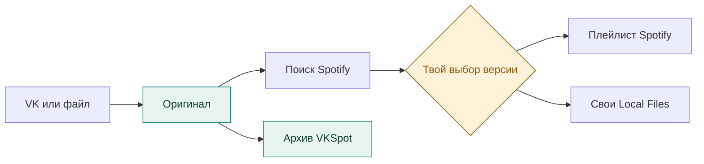

<p align="center">
  
</p>

<h1 align="center">VKSpot</h1>

<p align="center">
  <strong>Твоя музыка из VK — в Spotify.</strong><br>
  С сохранением оригинала, порядка и версий.
</p>

<p align="center">
  <kbd>Windows 10/11 · x64</kbd>&ensp;
  <kbd>Локальные данные</kbd>&ensp;
  <kbd>Светлая и тёмная темы</kbd>&ensp;
  <a href="LICENSE"><kbd>MIT</kbd></a>
</p>

<p align="center">
  <a href="#возможности">Возможности</a> ·
  <a href="#что-потребуется">Требования</a> ·
  <a href="#быстрая-установка">Установка</a> ·
  <a href="#от-списка-к-плейлисту">Перенос</a> ·
  <a href="#для-разработчиков">Разработка</a>
</p>

---

## Возможности

VKSpot — бесплатное приложение с открытым кодом для архивации медиатеки VK и подготовки переноса в Spotify. Оно помогает найти нужные версии песен; спорные совпадения выбираешь ты.

| Возможность              | Что получаешь                                                                                                            |
| ------------------------ | ------------------------------------------------------------------------------------------------------------------------ |
| 📥 **Архив медиатеки**   | Выгрузка «Моей музыки» из VK или импорт JSON, CSV, TXT. Исходные названия, позиции и отдельные повторы сохраняются.      |
| 🔎 **Проверка версий**   | Сравнение исполнителя, названия и длительности. Подтверждение подходящих результатов группой или разбор по одной записи. |
| 🎧 **Плейлист Spotify**  | Перенос подтверждённых треков через API. Поиск и перенос можно приостановить и продолжить после перезапуска.             |
| 📂 **Свои аудиофайлы**   | Привязка редких записей, подготовка копий для Local Files и план общего порядка.                                         |
| ↩️ **Обратимые решения** | Правки рабочей копии, отмена, откладывание и исключение записей. Оригинал остаётся в архиве.                             |

### Рабочее пространство

<picture>
  <source media="(prefers-color-scheme: dark)" srcset="docs/images/workspace-dark.png">
  
</picture>

<p align="center">
  <sub>Настоящий интерфейс на вымышленных данных. Тема снимка следует теме GitHub.</sub><br>
  <a href="docs/images/workspace-light.png">Светлая тема ↗</a> ·
  <a href="docs/images/workspace-dark.png">Тёмная тема ↗</a>
</p>

## Что потребуется

**Для запуска — Windows 10/11 x64.** Node.js для готового установщика не нужен.

Остальное зависит от твоей задачи:

| Задача                  | Что понадобится                                                                  |
| ----------------------- | -------------------------------------------------------------------------------- |
| Работать локально       | Файл JSON, CSV, TXT или архив VKSpot                                             |
| Забрать список из VK    | Интернет и вход в свой аккаунт во встроенном окне                                |
| Искать версии в Spotify | Доступ к веб-плееру; при запросе сервиса — вход или проверка. Client ID не нужен |
| Создать плейлист        | Аккаунт Spotify и личное приложение в Developer Dashboard                        |
| Добавить редкие версии  | Свои аудиофайлы и настольный Spotify с включёнными Local Files                   |

> [!IMPORTANT]
> Для Spotify API в режиме разработки нужен **Premium у владельца API-приложения**. Действуют квоты и список разрешённых пользователей. Это условие создания плейлиста через API; работа со своим архивом остаётся локальной. [Правила Spotify →](https://developer.spotify.com/documentation/web-api/concepts/quota-modes)

При необходимости в «Подключениях» можно настроить отдельные HTTP/SOCKS5-прокси для Spotify и VK.

## Быстрая установка

1. **📦 Установи приложение**<br>
   Открой **Releases → Assets** на странице репозитория. Скачай `VKSpot Setup <версия>.exe` и запусти установщик.

2. **📥 Добавь свою музыку**<br>
   В VKSpot открой **Подключения → VK → Открыть VK**, войди и нажми **Выгрузить мой список**. Для уже сохранённого файла выбери **Импорт списка**.

3. **🔎 Запусти поиск**<br>
   Проверь количество, первые и последние записи. Начни поиск из «Обзора» или коллекции и переходи к проверке версий.

Если готового релиза ещё нет, приложение можно [собрать из исходников](#для-разработчиков).

## От списка к плейлисту



> [!TIP]
> **Найдено ≠ выбрано.** Проверь версии и подтверди решения. Для создания плейлиста [подключи Spotify API](docs/workflows.md#подключение-spotify-api), затем нажми **Проверить перенос**.

### Если нужной версии нет

Привяжи файл с компьютера. VKSpot копирует его без перекодирования; добавление через Local Files и проверка смешанного порядка требуют действий в настольном Spotify. Файлы должны быть доступны на устройстве воспроизведения.

### Как сохранить резервную копию

Открой параметры коллекции и сохрани **полный архив VKSpot**: список и решения, без аудиофайлов. Также доступны исходный JSON, CSV, план переноса и M3U8.

## Ограничения и приватность

- VKSpot архивирует список и готовит перенос; скачивания музыки из VK в приложении нет.
- Разметка VK/Spotify, доступность треков и ограничения сервисов меняются. Сверяй полноту выгрузки; пустой поиск не доказывает отсутствие трека.
- Коллекции, история и настройки хранятся локально. Телеметрии нет; обращения к VK и Spotify нужны для их функций. Подробнее — [безопасность и приватность](SECURITY.md).

## Для разработчиков

<details>
<summary><strong>Запуск из исходников и сборка установщика</strong></summary>

Потребуются **Windows x64 и Node.js 24 LTS с npm**; для клонирования — Git. Склонируй этот репозиторий или распакуй **Code → Download ZIP**, затем открой PowerShell в папке проекта:

**Запуск в режиме разработки**

```powershell
npm ci
npm run dev
```

**Сборка Windows-установщика**

```powershell
npm run dist:win
```

Результат — `release/<версия>/VKSpot Setup <версия>.exe`.

Начни с [правил проекта](AGENTS.md) и [команд проверки](docs/maintenance.md).

</details>

<details>
<summary><strong>Карта документации проекта</strong></summary>

| Документ                              | Содержание                                   |
| ------------------------------------- | -------------------------------------------- |
| [Рабочие процессы](docs/workflows.md) | Импорт, подключение Spotify, поиск и перенос |
| [Продукт](PRODUCT.md)                 | Возможности и неизменяемые правила           |
| [Архитектура](docs/architecture.md)   | Модули, хранение и синхронизация             |
| [Дизайн](DESIGN.md)                   | Токены и правила интерфейса                  |

</details>

## Обратная связь и участие

Для ошибки создай **Issue**: укажи версию VKSpot, версию Windows, шаги и ожидаемый результат. Прикладывай только обезличенные примеры. Об уязвимостях сообщай по [SECURITY.md](SECURITY.md).

---

<p align="center">
  <strong>VKSpot</strong> · <a href="LICENSE">Открытый код · MIT</a><br>
  <sub>Независимый проект, не связанный с VK или Spotify.<br>
  Права на названия и знаки сервисов принадлежат их владельцам.</sub>
</p>
