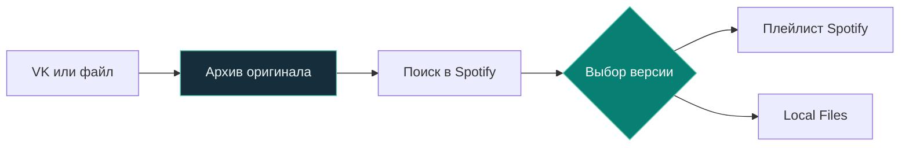
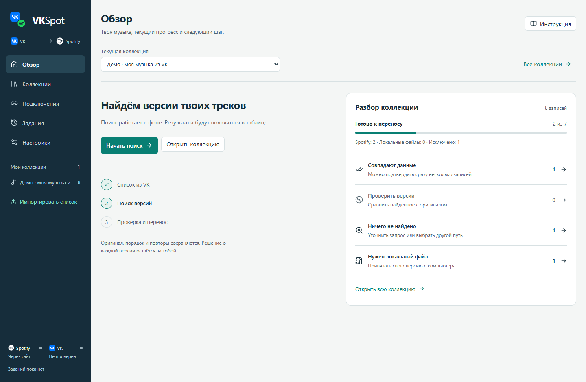

<p align="center">
  
</p>

<h1 align="center">VKSpot</h1>

<p align="center">
  <strong>Локальный архив музыки VK и контролируемый перенос в Spotify.</strong><br>
  Исходные названия, порядок, повторы и выбор версий остаются за тобой.
</p>

<p align="center">
  <a href="https://github.com/Matvey77/VKSpot/releases/latest">
    
  </a>
  <a href="https://github.com/Matvey77/VKSpot/actions/workflows/checks.yml">
    
  </a>
  <a href="#скачивание-и-установка">
    
  </a>
  <a href="LICENSE">
    
  </a>
</p>

<p align="center">
  <a href="https://github.com/Matvey77/VKSpot/releases/latest"><strong>Скачать релиз →</strong></a>
  &nbsp;&nbsp;·&nbsp;&nbsp;
  <a href="#как-это-работает">Как это работает</a>
  &nbsp;·&nbsp;
  <a href="#интерфейс">Интерфейс</a>
  &nbsp;·&nbsp;
  <a href="#скачивание-и-установка">Установка</a>
  &nbsp;·&nbsp;
  <a href="#для-разработчиков">Разработка</a>
</p>

<p align="center">
  <picture>
    <source media="(prefers-color-scheme: dark)" srcset="docs/images/workspace-dark.png">
    
  </picture>
</p>

---

## Главное

- **Неизменяемый архив.** Выгружает «Мою музыку» из VK или импортирует JSON, CSV, TXT. Оригинальные названия, позиции и повторы сохраняются отдельно от рабочих правок.
- **Контроль версий.** Сравнивает исполнителя, название и длительность. Точные совпадения можно подтвердить группой, спорные — проверить вручную в инспекторе.
- **Плейлист и `Local Files`.** Переносит выбранные треки через Spotify API и готовит копии редких аудиофайлов без перекодирования с сохранением общего порядка.
- **Локальность и обратимость.** База SQLite хранится на твоём компьютере; облака, телеметрии и скачивания аудио из VK нет. Фоновые задания переживают перезапуск, решения можно отменить ([PRODUCT.md](PRODUCT.md), [SECURITY.md](SECURITY.md)).

## Как это работает



1. **Добавь список** — открой **Подключения → VK**, выгрузи «Мою музыку» и сверь число, первую и последнюю записи ([подробнее](docs/workflows.md#импорт-и-выгрузка-vk)), либо нажми **Импорт списка** для JSON, CSV, TXT или архива VKSpot.
2. **Запусти поиск** — поиск версий работает через веб-плеер Spotify и не требует Client ID.
3. **Подтверди версии** — **найдено ≠ выбрано**: прими совпадения группой, уточни спорные треки в инспекторе или привяжи свой аудиофайл для `Local Files`.
4. **Перенеси и сохрани копию** — [подключи Spotify API](docs/workflows.md#подключение-spotify-api) для создания плейлиста и сохрани полную резервную копию JSON в **Параметрах коллекции** ([очереди и форматы экспорта](docs/workflows.md#очереди-и-перенос)).

> [!NOTE]
> Для создания плейлиста действуют квоты Spotify Development Mode; локальная работа и поиск от API не зависят. В **Подключениях** можно задать отдельные HTTP/SOCKS5-прокси для VK и Spotify.

## Интерфейс

<table>
  <tr>
    <td width="50%" align="center">
      <picture>
        <source media="(prefers-color-scheme: dark)" srcset="docs/images/overview-dark.png">
        
      </picture>
      <br><sub><strong>Обзор</strong> — прогресс коллекции и очереди проверки</sub>
    </td>
    <td width="50%" align="center">
      <picture>
        <source media="(prefers-color-scheme: dark)" srcset="docs/images/archive-dark.png">
        
      </picture>
      <br><sub><strong>Архив и экспорт</strong> — резервная копия, CSV, JSON и M3U8</sub>
    </td>
  </tr>
</table>

<p align="center">
  <sub>Снимки сделаны на демонстрационной коллекции и подстраиваются под тему GitHub.</sub>
</p>

## Скачивание и установка

Скачай сборку для своей системы из [последнего релиза](https://github.com/Matvey77/VKSpot/releases/latest) (Node.js не нужен, контрольные суммы — в `SHA256SUMS.txt`):

| Система           | Архитектура                            | Файл в Assets                      | Установка                                    |
| ----------------- | -------------------------------------- | ---------------------------------- | -------------------------------------------- |
| **Windows 10/11** | `x64`, `ARM64`                         | `VKSpot.Setup.<версия>-<arch>.exe` | Запусти установщик                           |
| **macOS 13+**     | Intel (`x64`), Apple Silicon (`arm64`) | `VKSpot-<версия>-mac-<arch>.dmg`   | Перенеси VKSpot в «Программы»                |
| **Linux**         | `x64` (`x86_64`), `ARM64` (`arm64`)    | `.AppImage`, `.deb`                | Сделай AppImage исполняемым или установи DEB |

<details>
<summary><strong>Проверка подписи, SHA-256 и особенности платформ</strong></summary>

- **Windows:** установщики не подписаны сертификатом издателя. Проверить хеш против `SHA256SUMS.txt` можно в PowerShell:

  ```powershell
  Get-FileHash -Algorithm SHA256 -LiteralPath "C:\путь\к\установщику.exe"
  ```

- **macOS:** сборки подписаны ad hoc без нотарификации ([справка Apple](https://support.apple.com/ru-ru/102445)). Архитектуру смотри в меню Apple → «Об этом Mac».
- **Linux:** нужны графическая сессия, песочница Chromium (при ограничениях используй `.deb` вместо `.AppImage`, см. [docs/maintenance.md](docs/maintenance.md)) и системное хранилище секретов для токена Spotify API ([SECURITY.md](SECURITY.md)). Архитектуру показывает `uname -m`; запуск AppImage:

  ```bash
  chmod +x ./VKSpot-<версия>-linux-x86_64.AppImage
  ./VKSpot-<версия>-linux-x86_64.AppImage
  ```

</details>

## Для разработчиков

Требуется **Node.js 24 LTS** с npm:

```bash
npm ci
npm run dev
```

| Документ                                    | О чём                                                                                            |
| ------------------------------------------- | ------------------------------------------------------------------------------------------------ |
| [Рабочие процессы](docs/workflows.md)       | Выгрузка VK, подключение Spotify API, поиск и перенос                                            |
| [Архитектура](docs/architecture.md)         | Модули, SQLite, синхронизация и [карта изменений](docs/architecture.md#как-проследить-изменение) |
| [Поддержка и сборки](docs/maintenance.md)   | Платформенные сборки, тесты, бенчмарки и инструменты                                             |
| [Продукт](PRODUCT.md) и [дизайн](DESIGN.md) | Инварианты продукта, токены и правила интерфейса                                                 |
| [Безопасность](SECURITY.md)                 | Модель приватности и сообщение об уязвимостях                                                    |
| [Правила разработки](AGENTS.md)             | Версионирование, коммиты и стандарты изменений                                                   |

Сообщить об ошибке можно в [Issues](https://github.com/Matvey77/VKSpot/issues/new) (укажи версию, ОС, архитектуру и обезличенный пример). Об уязвимостях сообщай по [SECURITY.md](SECURITY.md).

---

<p align="center">
  <strong>VKSpot</strong> · <a href="LICENSE">MIT License</a><br>
  <sub>Независимый проект с открытым кодом, не связанный с VK или Spotify. Права на знаки принадлежат их владельцам.</sub>
</p>
