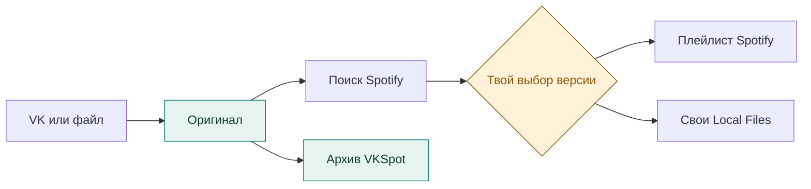
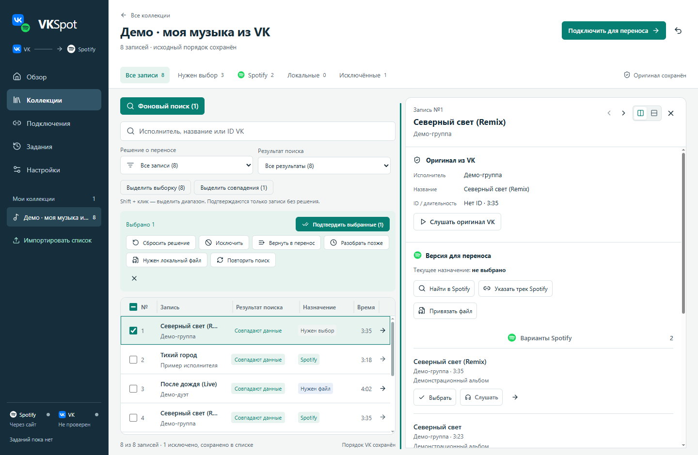
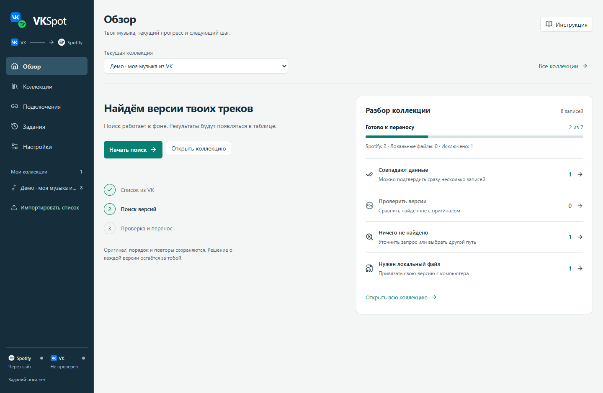
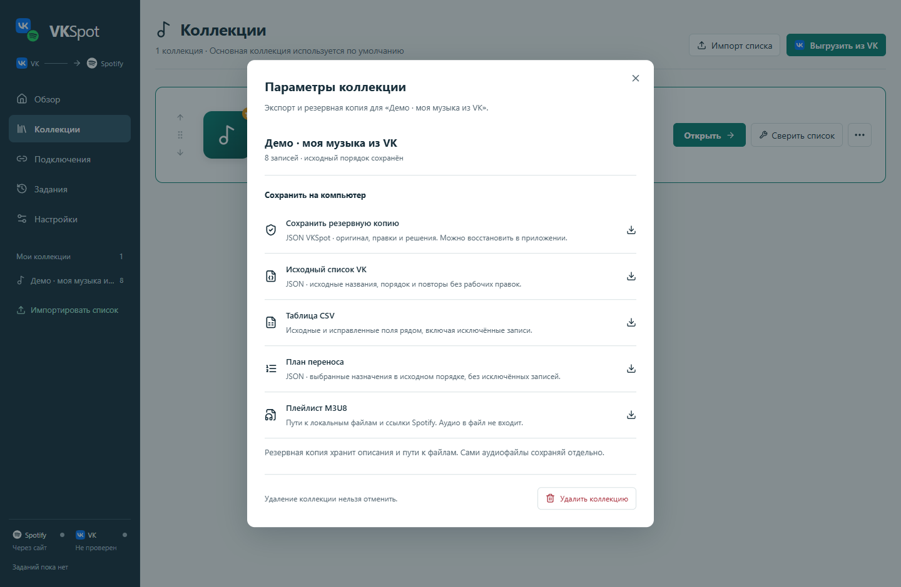

<p align="center">
  
</p>

<h1 align="center">VKSpot</h1>

<p align="center">
  <strong>Твоя музыка из VK — в Spotify.</strong><br>
  С сохранением оригинала, порядка и версий.
</p>

<p align="center">
  <a href="https://github.com/Matvey77/VKSpot/releases/latest">
    
  </a>
  <a href="https://github.com/Matvey77/VKSpot/actions/workflows/checks.yml">
    
  </a>
  
  <a href="LICENSE">
    
  </a>
</p>

<p align="center">
  <a href="https://github.com/Matvey77/VKSpot/releases/latest"><strong>📦 Скачать VKSpot</strong></a>
</p>

<p align="center">
  <a href="#возможности">Возможности</a> ·
  <a href="#что-потребуется">Требования</a> ·
  <a href="#скачивание-и-установка">Скачать</a> ·
  <a href="#от-списка-к-плейлисту">Перенос</a> ·
  <a href="#скриншоты">Скриншоты</a> ·
  <a href="#частые-вопросы">Помощь</a> ·
  <a href="#для-разработчиков">Разработка</a>
</p>

---

## Возможности

VKSpot — бесплатное приложение с открытым кодом для архивации медиатеки VK и подготовки переноса в Spotify. Оно помогает найти нужные версии песен; спорные совпадения выбираешь ты.

| Возможность              | Что получаешь                                                                                                            |
| ------------------------ | ------------------------------------------------------------------------------------------------------------------------ |
| 📥 **Архив медиатеки**   | Выгрузка «Моей музыки» из VK или импорт JSON, CSV, TXT. Исходные названия, позиции и отдельные повторы сохраняются.      |
| 🔎 **Проверка версий**   | Сравнение исполнителя, названия и длительности. Подтверждение подходящих результатов группой или разбор по одной записи. |
| 🎧 **Плейлист Spotify**  | Перенос подтверждённых треков через API. Поиск и перенос можно приостановить и продолжить после перезапуска.             |
| 📂 **Свои аудиофайлы**   | Привязка редких записей, подготовка копий для Local Files и план общего порядка.                                         |
| ↩️ **Обратимые решения** | Правки рабочей копии, отмена, откладывание и исключение записей. Оригинал остаётся в архиве.                             |

## Что потребуется

**Для запуска — Windows 10/11, macOS 13 или новее либо Linux на x64 или ARM64.** Node.js для готового приложения не нужен. Для Linux нужны графический рабочий стол и работающая песочница Chromium; для сохранения сессии Spotify API — системное защищённое хранилище секретов.

Остальное зависит от твоей задачи:

| Задача                  | Что понадобится                                                                  |
| ----------------------- | -------------------------------------------------------------------------------- |
| Работать локально       | Файл JSON, CSV, TXT или архив VKSpot                                             |
| Забрать список из VK    | Интернет и вход в свой аккаунт во встроенном окне                                |
| Искать версии в Spotify | Доступ к веб-плееру; при запросе сервиса — вход или проверка. Client ID не нужен |
| Создать плейлист        | Аккаунт Spotify и личное приложение в Developer Dashboard                        |
| Добавить редкие версии  | Свои аудиофайлы и настольный Spotify с включёнными Local Files                   |

> [!IMPORTANT]
> Для Spotify API в режиме разработки нужен **Premium у владельца API-приложения**. Действуют квоты и список разрешённых пользователей. Это условие создания плейлиста через API; работа со своим архивом остаётся локальной. [Правила Spotify →](https://developer.spotify.com/documentation/web-api/concepts/quota-modes)

При необходимости в «Подключениях» можно настроить отдельные HTTP/SOCKS5-прокси для Spotify и VK.

## Скачивание и установка

Открой [последний релиз](https://github.com/Matvey77/VKSpot/releases/latest) и выбери файл в разделе **Assets**:

| Система       | Архитектура   | Файл                                                                    |
| ------------- | ------------- | ----------------------------------------------------------------------- |
| Windows 10/11 | x64           | `VKSpot.Setup.0.2.0-x64.exe`                                            |
| Windows 10/11 | ARM64         | `VKSpot.Setup.0.2.0-arm64.exe`                                          |
| macOS 13+     | Intel         | `VKSpot-0.2.0-mac-x64.dmg`                                              |
| macOS 13+     | Apple Silicon | `VKSpot-0.2.0-mac-arm64.dmg`                                            |
| Linux         | x64           | `VKSpot-0.2.0-linux-x86_64.AppImage` или `VKSpot-0.2.0-linux-amd64.deb` |
| Linux         | ARM64         | `VKSpot-0.2.0-linux-arm64.AppImage` или `VKSpot-0.2.0-linux-arm64.deb`  |

Установщик содержит среду выполнения приложения. Для проверки файла в том же релизе есть [SHA256SUMS.txt](https://github.com/Matvey77/VKSpot/releases/latest/download/SHA256SUMS.txt).

Установщики Windows не подписаны сертификатом издателя. Сборки macOS подписаны ad hoc и не нотарифицированы Apple, поэтому Gatekeeper может препятствовать запуску. В Linux при ограничениях песочницы для AppImage можно использовать DEB с системным профилем.

### Быстрый старт

1. **📦 Установи приложение**<br>
   Скачай сборку для своей системы и архитектуры и установи приложение.

2. **📥 Добавь свою музыку**<br>
   В VKSpot открой **Подключения → VK → Открыть VK**, войди и нажми **Выгрузить мой список**. Для уже сохранённого файла выбери **Импорт списка**.

3. **🔎 Запусти поиск**<br>
   Проверь количество, первые и последние записи. Начни поиск из «Обзора» или коллекции и переходи к проверке версий.

Для самостоятельной сборки см. [раздел разработки](#для-разработчиков).

## От списка к плейлисту



> [!TIP]
> **Найдено ≠ выбрано.** Проверь версии и подтверди решения. Для создания плейлиста [подключи Spotify API](docs/workflows.md#подключение-spotify-api), затем нажми **Проверить перенос**.

### Если нужной версии нет

Привяжи файл с компьютера. VKSpot копирует его без перекодирования; добавь копию через Local Files в настольном Spotify. После добавления всех локальных записей можно сверить и восстановить смешанный порядок в VKSpot. Для сверки нужны корректные теги и длительность файлов; они должны быть доступны на устройстве воспроизведения.

### Как сохранить резервную копию

Открой параметры коллекции и сохрани **полный архив VKSpot**: список и решения, без аудиофайлов. Также доступны исходный JSON, CSV, план переноса и M3U8.

## Скриншоты

Настоящий интерфейс на вымышленной коллекции. Изображения переключаются вместе с темой GitHub; нажми на ссылки под снимком, чтобы открыть нужную тему в полном размере.

### Коллекция и проверка версий

Список и решения — слева, оригинал и кандидаты Spotify — в инспекторе справа.

<picture>
  <source media="(prefers-color-scheme: dark)" srcset="docs/images/workspace-dark.png">
  
</picture>

<p align="center">
  <a href="docs/images/workspace-light.png">Светлая тема ↗</a> ·
  <a href="docs/images/workspace-dark.png">Тёмная тема ↗</a>
</p>

<details>
<summary><strong>Обзор: прогресс и следующий шаг</strong></summary>

Обзор показывает состояние выбранной коллекции и открывает нужную очередь проверки.

<picture>
  <source media="(prefers-color-scheme: dark)" srcset="docs/images/overview-dark.png">
  
</picture>

<p align="center">
  <a href="docs/images/overview-light.png">Светлая тема ↗</a> ·
  <a href="docs/images/overview-dark.png">Тёмная тема ↗</a>
</p>

</details>

<details>
<summary><strong>Архив и экспорт: сохранить результат работы</strong></summary>

Резервная копия, исходный список, CSV, план переноса и M3U8 доступны из параметров коллекции.

<picture>
  <source media="(prefers-color-scheme: dark)" srcset="docs/images/archive-dark.png">
  
</picture>

<p align="center">
  <a href="docs/images/archive-light.png">Светлая тема ↗</a> ·
  <a href="docs/images/archive-dark.png">Тёмная тема ↗</a>
</p>

</details>

## Ограничения и приватность

- VKSpot архивирует список и готовит перенос; скачивания музыки из VK в приложении нет.
- Разметка VK/Spotify, доступность треков и ограничения сервисов меняются. Сверяй полноту выгрузки; пустой поиск не доказывает отсутствие трека.
- Коллекции, история и настройки хранятся локально. Телеметрии нет; обращения к VK и Spotify нужны для их функций. Подробнее — [безопасность и приватность](SECURITY.md).

## Частые вопросы

<details>
<summary><strong>Почему поиск работает, а плейлист не создаётся?</strong></summary>

Поиск через страницу Spotify и создание плейлиста через API подключаются отдельно. Проверь [настройку API](docs/workflows.md#подключение-spotify-api), Premium владельца API-приложения и статус задания: перенос может ожидать восстановления квоты.

</details>

<details>
<summary><strong>Что делать, если список из VK выгрузился не полностью?</strong></summary>

Сверь количество, первые и последние записи с VK. Если полнота не подтверждена, результат нельзя считать полным: страница могла загрузить только часть списка. Подробности — в [описании выгрузки VK](docs/workflows.md#импорт-и-выгрузка-vk).

</details>

<details>
<summary><strong>Почему Windows показывает неизвестного издателя?</strong></summary>

Установщик релиза 0.2.0 не подписан сертификатом издателя. Скачивай его из [официальных релизов проекта](https://github.com/Matvey77/VKSpot/releases/latest). Сверить SHA-256 можно в PowerShell, указав фактический путь к скачанному файлу:

```powershell
Get-FileHash -Algorithm SHA256 -LiteralPath "C:\путь\к\скачанному\установщику.exe"
```

Замени путь в примере и сравни результат с `SHA256SUMS.txt` из того же релиза.

</details>

## Для разработчиков

<details>
<summary><strong>Запуск из исходников и сборка установщика</strong></summary>

Потребуются **Node.js 24 LTS с npm** и целевая настольная ОС; для клонирования — Git. Склонируй этот репозиторий или распакуй **Code → Download ZIP**, затем открой терминал в папке проекта:

В текущих исходниках настроены сборки Windows 10/11 x64 и ARM64, macOS 13+ для Intel и Apple Silicon, а также Linux x64 и ARM64. Наличие сборки в исходниках или артефактах CI не означает, что она опубликована в релизе.

**Запуск в режиме разработки**

```powershell
npm ci
npm run dev
```

**Сборка установщика**

```powershell
npm run dist:win -- --x64
npm run dist:mac -- --arm64
npm run dist:linux -- --x64
```

Выбери команду для своей ОС и архитектуры (`--x64` или `--arm64`). Результат сохраняется в `release/<версия>/`: NSIS для Windows, DMG для macOS, AppImage и DEB для Linux. Сборка DMG выполняется на macOS. Для Linux нужны графический рабочий стол и работающая песочница Chromium, а для сохранения сессии Spotify API — системное защищённое хранилище секретов.

Начни с [правил проекта](AGENTS.md) и [команд проверки](docs/maintenance.md).

</details>

<details>
<summary><strong>Карта документации проекта</strong></summary>

| Документ                              | Содержание                                   |
| ------------------------------------- | -------------------------------------------- |
| [Рабочие процессы](docs/workflows.md) | Импорт, подключение Spotify, поиск и перенос |
| [Продукт](PRODUCT.md)                 | Возможности и неизменяемые правила           |
| [Архитектура](docs/architecture.md)   | Модули, хранение и синхронизация             |
| [Дизайн](DESIGN.md)                   | Токены и правила интерфейса                  |
| [Поддержка](docs/maintenance.md)      | Сборки, проверки и инструменты               |
| [Безопасность](SECURITY.md)           | Приватность и сообщение об уязвимостях       |

</details>

## Обратная связь и участие

Для ошибки создай [Issue](https://github.com/Matvey77/VKSpot/issues/new): укажи версию VKSpot, систему и архитектуру, шаги и ожидаемый результат. Прикладывай только обезличенные примеры. Об уязвимостях сообщай по [SECURITY.md](SECURITY.md).

---

<p align="center">
  <strong>VKSpot</strong> · <a href="LICENSE">Открытый код · MIT</a><br>
  <sub>Независимый проект, не связанный с VK или Spotify.<br>
  Права на названия и знаки сервисов принадлежат их владельцам.</sub>
</p>
