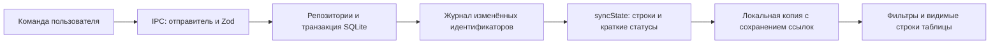

# Структура и границы модулей

Архитектура VKSpot 0.1.31 разделяет предметную логику, доступ к ОС, хранение, обмен состоянием и интерфейс. Размещение определяется ответственностью модуля.

```text
src/
├── core/
│   ├── collection/          # Импорт, целостность, экспорт, синхронизация, план переноса
│   ├── matching.ts          # Детерминированные правила сопоставления
│   ├── library.ts           # Общий анализ строк и сводки коллекций
│   └── vk-import.ts         # Проверка результата адаптера VK
├── shared/
│   ├── model.ts             # Доменные типы, схемы на границах и контракт Bridge
│   ├── defaults.ts          # Значения по умолчанию без зависимости от Zod
│   ├── sync.ts              # Курсор, дельты коллекций, краткие статусы заданий
│   └── job-status.ts        # Общая логика пауз, сроков ожидания и сообщений
├── main/
│   ├── index.ts             # Создание окна, сервисов и завершение приложения
│   ├── ipc/                 # Проверка отправителя, валидация и маршрутизация команд
│   ├── storage/
│   │   ├── index.ts         # Фасад Store
│   │   ├── database.ts      # SQLite, транзакции и подготовленные SQL-запросы
│   │   ├── collection-repository.ts # Коллекции, индексы строк и история правок
│   │   ├── collection-changes.ts    # Ограниченный журнал изменений для IPC
│   │   ├── job-repository.ts       # Прогресс отдельно от больших входных данных очереди
│   │   └── preferences.ts         # Настройки и поисковый кэш
│   ├── jobs/runner.ts       # Персистентная очередь поиска и переноса
│   ├── integrations/
│   │   ├── spotify/        # Официальный API и поиск по странице
│   │   └── vk/             # Браузерная сессия, аудио, классификация состояния
│   └── platform/           # Файлы, системные диалоги, прокси, Windows helper
├── preload/index.ts        # Единственный мост между изолированными процессами
└── renderer/src/
    ├── app/                # Оболочка, контроллер, навигация и размещение диалогов
    ├── state/              # Локальная копия состояния и объединение запросов
    ├── features/
    │   ├── library/        # Фильтры и выборка
    │   │   ├── table/      # Только видимые строки, изменение ширины столбцов
    │   │   └── inspector/  # Редактирование и сравнение версий, ширина панели
    │   ├── collections/    # Списки, импорт, сверка, параметры и все форматы экспорта
    │   ├── connections/    # VK, Spotify и настройки подключений
    │   ├── jobs/           # Прогресс и восстановление плейлистов
    │   ├── settings/       # Пользовательские параметры
    │   ├── start/          # Обзор, очереди разбора и отложенно загружаемое руководство
    │   └── transfer/       # Подтверждение переноса
    ├── components/         # Общие кнопки, знаки сервисов, панель состояния
    ├── hooks/              # Общие хуки
    ├── styles/             # Тематические разделы стилей
    ├── style.css           # Точный порядок импорта CSS; каскад сохраняется
    └── assets/             # Исходные брендовые ресурсы и снимки руководства
```

## Поток данных



`state()` остаётся полным снимком для диагностики и совместимости. Рабочий интерфейс использует `syncState(cursor)`: начальный снимок, затем только изменённые строки и метаданные. При смене процесса или истечении журнала выполняется полная повторная синхронизация. Курсор подтверждается только после успешного применения ответа.

`job_details` хранит списки идентификаторов и план переноса отдельно от часто обновляемого `jobs.payload`. Перенос старого формата выполняется транзакционно; публичный метод `state()` продолжает возвращать полные задания. В представления передаётся `JobSummary` без плана и списка тысяч идентификаторов.

## Правила зависимостей

- `core` не импортирует Electron или React. Предметные правила не размещаются в обработчиках событий интерфейса.
- `shared/defaults.ts` не импортирует схемы во время выполнения: интерфейс не должен загружать Zod ради констант.
- Главный процесс владеет SQLite, сетью и файлами. Рендерер вызывает только типизированный Bridge.
- Кэш строки зависит от её идентичности и набора правил сопоставления. Новая рабочая копия создаёт новую строку; неизменённые строки сохраняют ссылки.
- Исходный хэш проверяет оригинал, а не изменения рабочей копии. Использовать его для пропуска обновлений интерфейса нельзя.
- Изменения базы и истории атомарны. Журнал IPC обновляется после успешного коммита транзакции.
- Обработчики перетаскивания объединяют движения через `requestAnimationFrame`; предпочтения записываются по окончании жеста. Слушатели снимаются при завершении и размонтировании.
- Руководство загружается по запросу. Устаревшие экраны и неиспользуемые компоненты удаляются вместе со стилями.

## Проверки и артефакты

`tests/unit/` проверяет правила, транзакции, миграцию очереди и сохранение ссылок при применении дельт. `tests/e2e/` запускает настоящий Electron в изолированных профилях. Сценарий производительности проверяет ограниченный размер дельты, отсутствие фоновых запросов полного снимка и виртуализацию таблицы из 9000 строк.

`tools/performance/benchmark.cjs` воспроизводит замер на синтетической библиотеке. Методика и результаты находятся в [performance-review.md](performance-review.md).

`node_modules/`, `out/`, `release/` и `.local/` исключены из Git. Настоящая `collection.db`, токены и профили браузеров хранятся в системной папке данных приложения, показанной в настройках.
